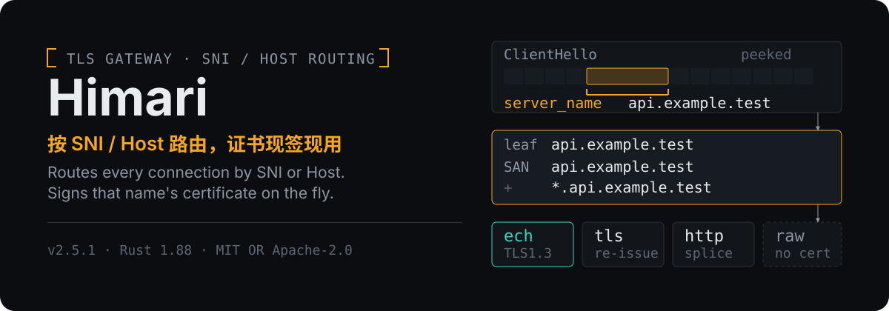
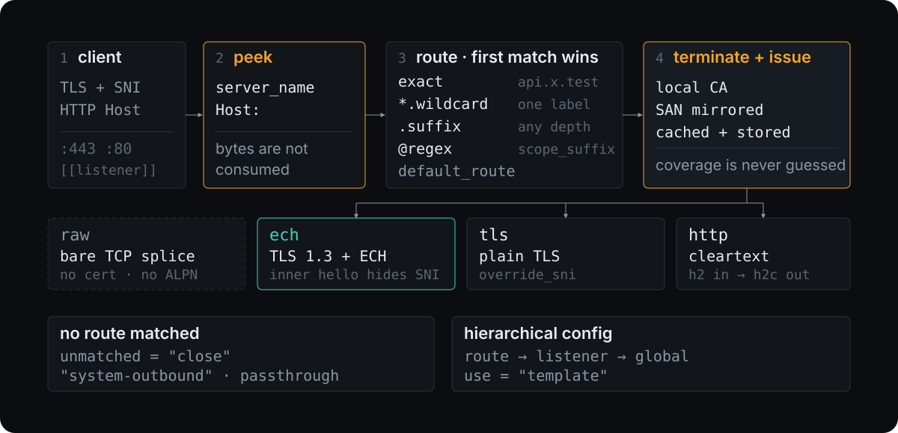

<p align="center">
  
</p>

<p align="center">
  <a href="#top">中文</a> · <a href="#english">English</a>
</p>

<a id="top"></a>

## Himari 是什么

Himari 是一个**单二进制、多监听的 TLS 网关**。每条连接按 TLS 的 **SNI**（或 HTTP 的 `Host`）选路由；凡是它终止 TLS 的地方，都会**现签一张覆盖该名字的证书**——由本地 CA 签，除非该路由用 `cert_file`/`key_file` 钉了自己的证书（那样就不走 CA 了）。上游可以四种方式抵达：`ech`、`tls`、`http`、`raw`。配置是分层的（route → listener → global），几乎每一项都能在单条路由上钉死，否则向外继承。

> **命名说明**：Cargo package、二进制与默认配置文件目前仍沿用上游名 `sni-gate`（`sni-gate.toml`、`SNI_GATE_LOG`）。下面的命令按**实际产物**写，项目对外名称是 Himari。

两件事是它存在的理由：

- **逐 SNI 现签证书** —— 不需要逐站维护证书。任何名字第一次被请求时就能拿到有效证书（你只需信任一次本地 CA）。覆盖范围**不是猜的**：首个握手精确应答，更宽的覆盖从上游自己的证书镜像而来。证书有缓存，也持久化到磁盘。
- **ECH 重新发起** —— 对到 CDN 边缘这一段把真实 SNI 藏起来，让本身不支持 ECH 的客户端和环境也能用上。

## 30 秒跑起来

```sh
cargo build --release
cp sni-gate.example.toml sni-gate.toml      # 然后编辑它

sudo ./target/release/sni-gate --install-ca # 生成本地 CA 并装进系统信任库
sudo ./target/release/sni-gate              # 读取 ./sni-gate.toml
```

- 换配置路径用 `-c <path>`。`--version` / `--help` 可用，**没有子命令**。
- 绑 443/80 需要特权：Windows 管理员，macOS/Linux root。
- 日志优先级：`SNI_GATE_LOG` → `RUST_LOG` → 配置里的 `global.log`（默认 `info`）。
- 只想要产物：每个 release 附 **8 个目标**（Linux gnu/musl × x86_64/aarch64、Windows MSVC 动态+静态、macOS aarch64+x86_64）与 `SHA256SUMS`。Linux/Windows 的 `-static` 变体不依赖运行时。

## 一条连接怎么走

<p align="center">
  
</p>

1. **peek**：只看不吃——不消费任何字节，取出路由键（TLS 的 `server_name`，或 HTTP 的 `Host`）。
2. **route**：按优先级匹配，第一个命中即生效。
3. **terminate + issue**：除 `raw` 外都终止入站 TLS，用本地 CA 为该名字签一张叶子证书，再按路由类型重新发起上游连接。`raw` 把未改动的 TCP 流直接拼过去。
4. **没命中也没有 `default_route`** 时，执行全局 `unmatched` 策略。

## 路由匹配：顺序即语义

| 优先级 | 写法 | 含义 |
|---|---|---|
| 1 | `api.example.test` | 精确名 |
| 2 | `*.example.test` | 通配，**只吃一层标签** |
| 3 | `.example.test` | 后缀，任意深度 |
| 4 | `@my_regex` | 命名正则，按**路由声明顺序**逐个尝试 |
| 5 | `default_route` | 该监听器的兜底 |
| 6 | `unmatched` | `"close"`（默认）· `"system-outbound"` · `{ mode = "passthrough", addr = "host:port" }` |

- 主机名统一转小写并去掉尾部 `.`。
- `match_sni` 里的正则**必须**先在 `[regexes.<name>]` 声明，并且**必须**带 `scope_suffix`（非空）；内联 `~...` 写法在加载期直接拒绝。
- 监听地址三种写法：`"0.0.0.0:443"`、`"[::]:443"`、裸端口 `"443"`/`443`。裸端口只绑 **IPv4 通配**（与 nginx `listen 443` 同语义），要 IPv6 就再加一个 `"[::]:443"`。`"443"` 与 `"0.0.0.0:443"` 归一化成同一地址，同时写会在启动时报重复监听。不接受主机名。

## 证书覆盖：不猜，只镜像

<p align="center">
  
</p>

一张证书覆盖多少**不可配置**。之所以不让它可配，是因为「猜宽一点」会直接破坏 HTTP/2：比上游更宽的证书会授权浏览器把请求合并到上游不该答的路径上（表现为 `403`）。所以覆盖范围**永远由上游的真实证书决定**，不由本网关提议。唯一的例外是钉了 `cert_file`/`key_file` 的路由：覆盖范围就是你给的那张证书，既不镜像也不重签。

- **先精确。** 上游从未被观测过的主机，首个连接只拿到那一个名字的证书，没有通配——没有东西能合并上来。
- **再镜像。** **反射入站名字**的路由把连接交给 TLS/ECH 上游时，上游叶子证书在**本来就要发生的那次握手**里被读走（不额外探测、不阻塞），它的 DNS SAN 就成为该名字在这个网关上的覆盖范围。固定 `override_sni` 或钉了 `cert_file` 的路由不参与镜像——它们的覆盖由操作者决定。
- **按请求的名字记账。** 为 `t4.origin.example` 学到的 SAN 集合，绝不会发给请求 `origin.example` 的客户端。
- **轮换靠逐次比对。** 原始观测集合与证书一起存。后续握手若给出不同集合——**包括更窄的集合**（忽略它正是重新引入 `403` 的那条路）——缓存叶子即失效并按新集合重签。
- **裁剪。** 三种情况会丢掉镜像来的名字：① 上游虽然背书、但这个监听器会把该名字路由到别处；② 它是**公共后缀正上方的通配**（`*.com`、`*.co.uk`）——判定只看公共后缀列表的 **ICANN 段**，`co.uk`、`co.jp` 是边界，而私有段条目（`github.io`、`withgoogle.com`）是普通域名，所以上游真给的 `*.withgoogle.com` 会被镜像；③ 它本来就**不可签发**：IP 字面量、畸形条目、或任何 TLS 客户端都不会认的多级通配。被丢掉的名字会进日志，但**只记名字、不记原因**。
- **请求的名字一定在集合里。** 只要保留下来的名字没有覆盖到请求方本身（例如上游只给 `*.example.com`，而请求是 apex `example.com`），就把这个请求名补进 SAN——所以「全被裁光」和「幸存者碰不到它」走的是同一条路。
- **持久化。** 证书按 `(scope, host)` 存成 `certs/<scope>/<host>.crt`，连同产生它的观测集合，重启后接着镜像而不是重新学。没有需要迁移的东西，也没有开关：与上游当前呈现不符的叶子会直接重签。

## 上游池与自适应选路

<p align="center">
  
</p>

路由的 `upstream` 可以写成 `@pool_name`（或 `@pool_name:8443`），把选路交给一个**带后台探测的候选池**。

- **targets**：IP、域名，或 CIDR。CIDR 要么用 `[N]` 显式采样（`"104.16.0.0/12[4]"` = 随机取 4 个地址），要么整段展开——但整段**上限 64 个地址**，超过就在加载期拒绝并提示补 `[N]`。可以给目标打 `tags`，路由侧用 `select` 按索引或标签取子集：多个条件是**并集**（命中任一即可，没有 AND 也没有取反），写成空列表则表示**不过滤**——用于把模板带来的过滤放宽回全部。
- **probe**：`mode` 只能是 `tcp` / `tls` / `http`（**没有关闭探测这个选项**）。默认健康间隔 `interval = 300s`、降级间隔 `degraded_interval = 30s`、`fail_threshold = 2`、`max_concurrent_probes = 16`；`port` 默认 443，但**只对 `tcp`/`tls` 有意义**——`http` 模式下写 `port` 是加载期错误（端口在 URL 里）。RTT 依模式分别停在连上 / 握手完成 / 收到首个响应字节。
- **两个估计器**：RTT 上是卡尔曼滤波（配单侧 CUSUM 抓突变）；吞吐上是 **log-吞吐的 Normal-Inverse-Gamma 后验**。吞吐观测值来自**被动完成的传输**，不是探测结果。
- **每连接抽样**：对每个合格候选各抽一次它潜均值的精确 Student-t(2α) 边缘，分数 = 平滑 RTT（秒）+ `payload_bytes / 抽样吞吐`，取最优者拨号。
- **稳定性**：发布顺序上做**成对迟滞**——挑战者必须比在位者快出「在位者分数的 20%」这个余量（余量下限 5 ms），不是「差距的 20%」。此外每条路由视图还有**在位者粘滞**，但它**只在吞吐模式下生效**：`score_payload_bytes = 0`（默认）时直接取排序首位，粘滞代码根本不跑。
- **退避与保留**：探测失败的候选走**指数退避**；而**离开候选集合**的地址（域名记录轮换、被换掉的采样地址）其 Kalman/NIG 历史会 park 保留 600 s（固定常量，不可配），以便它回来时不必从零重学。
- **兜底与投影**：`fallback` 是目标索引，**只在健康集合为空时**使用；没有任何健康候选且没有 fallback 时，`pick` 直接失败、这条路由不拨号。`[pools.<n>.nat64]` 的 `prefixes`（RFC 6052 /96）会为每个参与候选**合成额外的 IPv6 候选**（打上 `nat64` + `ipv6` 标签），独立探测、独立排序。/24（v4）与 /48（v6）的**子网先验**由被动吞吐观测喂出来、再传给新出现的地址——所以它同样**只在吞吐模式下才有内容**。

三条必须说清的边界：

1. `score_payload_bytes` 默认是 **0**，这会**同时关掉吞吐遥测通道与抽样路径**——连带在位者粘滞与子网先验一起不生效。默认形态就是「在带迟滞的排序上取首位、纯平滑 RTT 选路」。要用自适应吞吐，得显式打开它。
2. **没有收敛或 no-regret 保证**。不确定度只会让排序更平滑，不做门控；探测成功/失败走的是独立的 `degraded` 标记，不进后验。
3. 用池会**接管解析路径**：不再走 `lookup_addr`，也不做双栈地址族竞速。因此**写在路由或路由模板上**的 `address_family` / `nat64_prefix` / `addr_resolver` 与池型 upstream 并存会在加载期被拒；从更宽作用域**继承**来的这些值则保持无害（由池接管，不会被误读成配置冲突）。证书 scope 以 `pool={name}` 记账。resolver 不允许经由池拨号。

## 分层配置与模板

`route → listener → global` 逐层继承，几乎每个键都能在更窄的作用域里覆盖；`use = "template"` 复用一组设置，**模板不可嵌套**。所有结构体都是 `deny_unknown_fields`——键名写错是**启动失败**，不是静默忽略。

## 上游证书校验

`[verify] mode` 取 `"full"`（默认）· `"chain"` · `"none"`。另有两个更值得优先用的字段：`name`（固定校验名）与 `pins`——**SPKI 公钥钉住**，写法 `sha256/<base64>`（RFC 7469 §2.1.1，与 `curl --pinnedpubkey` 同形），并且是**叠加**在 `mode` 的要求之上而不是替代它；`pins` 整列表覆盖，深层作用域是**换掉**继承来的集合而不是追加。`ca_file` 可加私有 CA（`mode = "none"` 下无意义，因为不建链），`trust_webpki` 默认 `true`。

任何弱化校验的配置都会在**启动时报告**。值得理解代价：客户端看到的仍然是这个网关的 CA 签出的证书，因此**客户端无法分辨远端有没有被检查过**。

## ECH、HTTP/2、地址族

- `[ech] mode = "doh" | "static" | "doh-with-fallback"`（默认 `doh`）、`require_ech` 默认 `true`、`max_retries` 默认 2、`ech_refresh` 默认 1h。
- `override_sni` 三种写法语义不同：省略 = 透传入站名字；`"name"` = 固定名字；`""` = **不发 SNI 扩展**。空串与省略是刻意区分的：对以 IP 寻址、或只按自己发的证书做区分的上游有用；ECH 场景下 [RFC 9849 §5](https://www.rfc-editor.org/rfc/rfc9849.html#section-5) 明确允许 inner ClientHello 不带 `server_name`（外层的 ECHConfig 公共名照发）。抑制 SNI 改变的是**发出去什么**，不是**信任什么**——上游证书仍按该路由本来要发的名字校验。
- `[http2] enabled` 默认 **false**。`probe = "off" | "warn" | "require"` 默认 `warn`：启动时探一次后端是否真说 h2c，但**探测只验证、不改判**——绝不会因为探测结果就悄悄把路由降级成 HTTP/1.1（那正好掩盖了需要被暴露的配置错误）。这个探测的适用范围很窄：只有 **`http` 路由 + `enabled` + `probe != off` + 上游是固定直连地址**才会探；池型上游（启动时还没 settled）与反射入站 SNI/Host 的路由（没有固定后端）会被跳过，并在 `debug` 日志里说明原因。`raw` 路由上显式开 `http2` 是加载期错误；从更宽作用域**继承**来的值会被忽略，所以全局 `enabled = true` 与 `raw` 路由可以共存。明文（非 TLS）入站连接**用不了** HTTP/2：prior-knowledge h2c 的 `:authority` 在 HPACK 压缩的 HEADERS 里，没有解码器状态就读不到，因此没有路由键，会落到 `default_route`。
- `address_family = "dual" | "ipv4" | "ipv6"`（默认 `dual`）。双栈上游会**同时向两个地址族发起竞速**，先通者胜——不会因为某一族不可达就判整条路由死刑。`nat64_prefix` 在解析上游地址时做 IPv4→IPv6 替换（`address_family = "ipv6"` 下不生效）。
- DNS 只作为**客户端**使用：`system` / `https://`（DoH）/ `tls://`（DoT）/ `udp://` / `tcp://`，可命名成 `[resolvers.<name>]` 并逐跳指定 ECH 与校验策略。

## 运行边界（请务必读）

- `ca/ca.key` 是**信任根私钥**，已 gitignore；对外只分发 `ca/ca.crt`。
- 终止 TLS 意味着对这些路由类型而言，Himari 看得到明文。
- **没有配置热重载**：改监听、路由、池、resolver 都要重启。唯一的热重载是 **PSL 文件**，而且要看条件：`[psl] auto_reload = true` **且** `source = "file"` **且**该文件此刻存在，watcher 才会起（文件缺失时只记一条 info，不会 arm）；`SIGHUP` 则是无条件只重载 PSL。
- 它**不是**：HTTP/SOCKS5 正向代理（没有 CONNECT，`type = "http"` 是明文转发）；没有 GUI / 托盘 / Web 界面；不是 DNS 拦截器或 fake-IP 服务；监听器**不校验客户端证书**（无 mTLS 入站认证）。
- 退出：Ctrl-C 或 SIGTERM。信号一到就停止接受新连接并以 **exit 0** 退出，但**不做连接排空**——在飞的拼接会被直接丢弃。另外信号处理器是在启动那段 `select` 里才装上的，所以**过早**发 TERM 会以「信号死亡」记账；外部控制器要等就绪再停，否则会把用户发起的停止误判成崩溃。

## 构建

```sh
cargo build --release
./build-release.sh        # 可复现 + 隐私加固：去符号、重映射构建路径

# 完全静态的 Linux 产物（不依赖 glibc）
rustup target add x86_64-unknown-linux-musl
cargo build --release --target x86_64-unknown-linux-musl

# 静态 Windows CRT（相当于 C 的 /MT）
RUSTFLAGS="-Ctarget-feature=+crt-static" cargo build --release
```

需要稳定版 Rust 工具链（`rust-version = 1.88`）；Windows 还需 NASM + C 工具链，因为 `aws-lc-rs` 提供 ECH 所需的 HPKE 套件。

## 测试与 CI

- **341 个测试函数**（`src/` 单元 + `tests/` 集成）。`tests/e2e.rs` 会拉起**真二进制**打真握手，覆盖：`raw` 字节直通、`http` 路由终止 TLS 并签证书、未观测上游只发 exact 证书、跨路由合并结构上不可能、模板端到端、h2 入站拼接 h2c 后端、关闭 http2 时仍协商 http/1.1。池与自适应选路另有 `tests/pool_e2e.rs`（含加载期拒绝的负例）与 `tests/pool_adaptive_e2e.rs`（在两次探测之间完成探索与学习）。
- CI：`cargo fmt --all -- --check` + `cargo clippy --all-targets --locked -- -D warnings`；构建与全量测试跑在 Linux x86_64、Linux arm64、Windows x86_64、macOS(aarch64)，其中 macOS 那一腿是 soft（`continue-on-error`），避免 runner 容量抖动阻塞判定。

## 配置参考

[`sni-gate.example.toml`](sni-gate.example.toml) 覆盖绝大多数键，含各层默认值与互斥关系；但不是全部——`cert_file`/`key_file`、`idle_timeout`、`scope_suffix` 就没有出现在里面，这些要看 `src/config.rs` 的字段注释。

## 许可证

MIT 或 Apache-2.0 双许可（见 `LICENSE-MIT`、`LICENSE-APACHE`）。

---

<a id="english"></a>

## What Himari is

Himari is a **single-binary, multi-listener TLS gateway**. Each connection is routed by its TLS **SNI** (or the HTTP `Host`), and wherever it terminates TLS it **issues a certificate for that name on the fly** — signed by a local CA, unless the route pins its own with `cert_file`/`key_file`, in which case the CA is not involved. Upstreams are reached four ways: `ech`, `tls`, `http`, `raw`. Configuration is hierarchical (route → listener → global), so almost every setting can be pinned per route and otherwise inherits outward.

> **On the name**: the Cargo package, the binary and the default config file still carry the upstream name `sni-gate` (`sni-gate.toml`, `SNI_GATE_LOG`). The commands below use the real artifact names; the project is Himari.

Two capabilities are the reason it exists:

- **Dynamic per-SNI issuance** — no per-site certificate maintenance. Any name gets a valid certificate the first time it is requested, from a CA you trust once. Coverage is not guessed: the first handshake is answered exactly, and wider coverage is mirrored from the upstream's own certificate. Issued certs are cached and persisted.
- **ECH re-origination** — hide the true SNI from the path to a CDN edge, giving ECH to clients and environments that cannot do it themselves.

## Run it in 30 seconds

```sh
cargo build --release
cp sni-gate.example.toml sni-gate.toml      # then edit it

sudo ./target/release/sni-gate --install-ca # generate the local CA, trust it
sudo ./target/release/sni-gate              # loads ./sni-gate.toml
```

- `-c <path>` for another config path. `--version` / `--help` exist; there are **no subcommands**.
- Binding 443/80 needs privilege: Administrator on Windows, root on macOS/Linux.
- Log precedence: `SNI_GATE_LOG` → `RUST_LOG` → config `global.log` (default `info`).
- Prebuilt: every release ships **8 targets** (Linux gnu/musl × x86_64/aarch64, Windows MSVC dynamic + static, macOS aarch64 + x86_64) with `SHA256SUMS`. The `-static` Linux/Windows builds need no runtime dependencies.

## The path of one connection

1. **peek** — read without consuming any bytes to get the routing key (`server_name`, or `Host`).
2. **route** — first match wins, in the order below.
3. **terminate + issue** — for every type except `raw`, terminate inbound TLS with a leaf signed by the local CA, then re-originate per route type. `raw` splices the untouched TCP stream.
4. **No match and no `default_route`** — the global `unmatched` policy applies.

## Route matching: the order is the semantics

| Rank | Form | Meaning |
|---|---|---|
| 1 | `api.example.test` | exact |
| 2 | `*.example.test` | wildcard, **one label** |
| 3 | `.example.test` | suffix, any depth |
| 4 | `@my_regex` | named regex, tried in **route declaration order** |
| 5 | `default_route` | this listener's fallback |
| 6 | `unmatched` | `"close"` (default) · `"system-outbound"` · `{ mode = "passthrough", addr = "host:port" }` |

- Hosts are lowercased and stripped of a trailing dot.
- A regex in `match_sni` **must** be declared as `[regexes.<name>]` **and** carry a non-empty `scope_suffix`; inline `~...` is rejected at load time.
- Listener `addr` accepts `"0.0.0.0:443"`, `"[::]:443"`, or a bare port `"443"` / `443`. A bare port binds the **IPv4 wildcard only** (nginx `listen 443` semantics) — add `"[::]:443"` for IPv6. `"443"` and `"0.0.0.0:443"` normalize to the same address, so writing both is a duplicate-listener error at startup. Hostnames are not accepted.

## Certificate coverage: mirrored, never guessed

How much a certificate covers is **not configurable**, because guessing wide is exactly what breaks HTTP/2: a certificate broader than the upstream's authorizes the browser to coalesce requests the upstream answers with `403`. Coverage is therefore **mirrored from the upstream's real certificate**, never proposed by this gateway. The one exception is a route that pins a `cert_file`/`key_file` pair: its coverage is whatever that certificate says, and nothing is mirrored or re-signed.

- **Exact first.** The first connection for a host whose upstream has never been observed gets a certificate for that one name — nothing can coalesce onto it.
- **Then mirror.** On a route that **reflects the inbound name**, the upstream leaf is read during the handshake that was happening anyway (no extra probe, no blocking) and its DNS SANs become this gateway's coverage for that host. Routes with a fixed `override_sni`, and routes that pin a `cert_file`, do not mirror — their coverage is the operator's choice.
- **Keyed by the requested name.** A SAN set learned while serving `t4.origin.example` is never handed to a client asking for `origin.example`.
- **Rotation by comparison.** The raw observed set is stored with the certificate. A later handshake presenting a different set — **including a narrower one**, the case that reintroduces `403` — invalidates and re-signs the cached leaf.
- **Clipping.** A mirrored name is dropped for three reasons: this listener would route it elsewhere; it is a wildcard directly above a public suffix (`*.com`, `*.co.uk`) — only the PSL's **ICANN section** draws that line, so `co.uk` and `co.jp` are boundaries while private-section entries (`github.io`, `withgoogle.com`) are ordinary domains and a genuine `*.withgoogle.com` is mirrored; or the name is simply **unmintable** (an IP literal, a malformed entry, or a multi-level wildcard no TLS client would honor). Dropped names are logged, **by name only** — the reason is not currently emitted.
- **The requesting host is always in the set.** Whenever the survivors do not cover the name that was actually requested (an upstream `*.example.com` does not cover the apex `example.com`), that host is appended — so "everything was clipped" and "the survivors happen not to cover it" take the same path.
- **Persisted** per `(scope, host)` as `certs/<scope>/<host>.crt` together with the observed set, so a restart resumes mirroring instead of re-learning. Nothing to migrate, no mode to switch: a leaf that no longer matches what the upstream presents is simply re-issued.

## Upstream pools and adaptive selection

A route's `upstream` may be `@pool_name` (or `@pool_name:8443`), handing selection to a candidate pool with background probing.

- **targets**: an IP, a domain, or a CIDR. Either sample it explicitly with `[N]` (`"104.16.0.0/12[4]"` draws 4 random addresses), or expand the whole range — which is **capped at 64 addresses** and refused at load time above that, with a hint to add `[N]`. Targets can carry `tags`, and a route's `select` narrows to an index or tag subset: multiple conditions are **OR-unioned** (there is no AND and no negation), while an explicitly empty list means **no filter** — the way to widen a template's filter back to everything.
- **probe**: `mode` is `tcp` / `tls` / `http` — **probing cannot be disabled**. Defaults: healthy `interval = 300s`, `degraded_interval = 30s`, `fail_threshold = 2`, `max_concurrent_probes = 16`; `port` defaults to 443 but **only means anything for `tcp`/`tls`** — writing it in `http` mode is a load-time error (the port lives in the URL). RTT stops at connect, handshake, or first response byte depending on mode.
- **Two estimators**: a Kalman filter over RTT (with a one-sided CUSUM for regime change), and a **Normal-Inverse-Gamma posterior over log-throughput**. Throughput observations come from **passive completed transfers**, not from probes.
- **Per-connection sampling**: each eligible candidate is drawn once from the exact Student-t(2α) marginal of its latent mean; score = smoothed RTT (seconds) + `payload_bytes / sampled_throughput`. Best score is dialed.
- **Stability**: pairwise **hysteresis on the published order** — a challenger must beat the incumbent by a margin of **20% of the incumbent's own score**, with a 5 ms floor (not 20% of the gap). There is also a **sticky incumbent** per route view, but it only runs in throughput mode: with `score_payload_bytes = 0` (the default) selection simply takes the head of the ranked order.
- **Backoff and retention**: a failing candidate gets exponential probe backoff, while an address that **left the candidate set** (a DNS rotation, a replaced sample) has its Kalman/NIG history parked for 600 s — a fixed constant, not configurable — so it does not relearn from zero when it comes back.
- **Fallback and projection**: `fallback` is a target index used **only while the healthy set is empty**; with nothing healthy and no fallback, `pick` fails and the route dials nothing. `[pools.<n>.nat64]` `prefixes` (RFC 6052 /96) **synthesize extra IPv6 candidates** per participating candidate (tagged `nat64` + `ipv6`), probed and ranked independently. Subnet priors (/24 for v4, /48 for v6) seed newly appeared addresses — but they are fed by passive throughput observations, so they only have content in throughput mode too.

Three limits worth stating plainly:

1. `score_payload_bytes` defaults to **0**, which switches off the throughput telemetry channel *and* the sampling path — including the sticky incumbent and the subnet priors. Out of the box a pool is plain smoothed-RTT selection over a hysteretic order. Turn it on to get throughput-aware routing.
2. There is **no convergence or no-regret guarantee**. Uncertainty only ever smooths the ranking; it never gates. Probe success/failure lives in a separate `degraded` flag, not in the posterior.
3. A pool **takes over the resolution path**: no `lookup_addr`, no dual-stack family racing. Writing `address_family` / `nat64_prefix` / `addr_resolver` **at route scope or on its route template** alongside a pool upstream is therefore rejected at load time, while the same values merely *inherited* from a broader scope stay harmless (the pool owns them). Certificate scope is keyed as `pool={name}`. Resolvers may not dial through a pool.

## Hierarchical configuration

`route → listener → global`, with almost every key overridable at the narrower scope. `use = "template"` reuses a block; **templates cannot nest**. Every struct is `deny_unknown_fields` — a misspelled key is a **startup failure**, not a silent ignore.

## Upstream certificate verification

`[verify] mode` is `"full"` (default), `"chain"`, or `"none"`. Two fields are usually the better answer than weakening: `name` (a fixed verification name) and `pins` — **SPKI pins**, spelled `sha256/<base64>` (RFC 7469 §2.1.1, the same form as `curl --pinnedpubkey`), which apply **in addition to** whatever `mode` requires rather than instead of it. `pins` is replaced wholesale at a deeper scope, never appended to, so a route cannot be quietly held to a set it cannot see. `ca_file` adds a private CA (meaningless under `mode = "none"`, which builds no chain); `trust_webpki` defaults to `true`.

Any policy that weakens verification is **reported at startup**, and it is worth understanding the cost: the client still sees a certificate this gateway's CA signed, so it cannot tell that the far end was not checked.

## ECH, HTTP/2, address families

- `[ech] mode = "doh" | "static" | "doh-with-fallback"` (default `doh`), `require_ech` default `true`, `max_retries` default 2, `ech_refresh` default 1h.
- `override_sni` distinguishes three cases: omitted = reflect the inbound name; `"name"` = fixed name; `""` = **send no `server_name`**. The empty string is deliberately distinct from omitting the field — useful for an IP-addressed upstream, or one that keys only off the certificate it serves; for ECH, [RFC 9849 §5](https://www.rfc-editor.org/rfc/rfc9849.html#section-5) explicitly allows an inner ClientHello with no `server_name` (the outer hello still carries the ECHConfig public name). Suppressing SNI changes what is **transmitted**, not what is **trusted**.
- `[http2] enabled` defaults to **false**. `probe = "off" | "warn" | "require"` defaults to `warn`: backends are checked at startup, but the probe **validates and never decides** — no route is silently downgraded to HTTP/1.1, because a cached verdict would go stale on the first backend reload and would hide the misconfiguration this exists to surface. Its scope is narrow: only **`http` routes with `enabled`, `probe != off`, and a fixed direct upstream** are probed. Pool upstreams (nothing settled at startup) and routes that reflect the source SNI/Host (no fixed backend) are skipped, with the reason logged at `debug`. Enabling `http2` on a `raw` route is a load-time error, while a value merely *inherited* from a broader scope is ignored, so a global `enabled = true` coexists with `raw` routes. Cleartext inbound connections cannot use HTTP/2 at all: a prior-knowledge h2c request carries its `:authority` in HPACK-compressed HEADERS, which cannot be read without decoder state, so there is no routing key and such connections fall through to `default_route`.
- `address_family = "dual" | "ipv4" | "ipv6"` (default `dual`). A dual-stack upstream is **raced on both families** — one unreachable family does not condemn the route. `nat64_prefix` substitutes IPv4→IPv6 while resolving upstream addresses (not in effect under `address_family = "ipv6"`).
- DNS is used **as a client only**: `system`, `https://` (DoH), `tls://` (DoT), `udp://`, `tcp://`, nameable as `[resolvers.<name>]` with per-hop ECH and verification policy.

## Operational boundaries (please read)

- `ca/ca.key` is a trusted-root private key and is gitignored; distribute only `ca/ca.crt`.
- Terminating TLS means Himari sees plaintext for the terminating route types.
- **There is no config hot-reload**: listeners, routes, pools and resolvers need a restart. The only reload that exists is for the **PSL file**, and it is conditional: the watcher starts only with `[psl] auto_reload = true` **and** `source = "file"` **and** that file present at startup (a missing file logs one `info` line and does not arm). `SIGHUP` reloads the PSL unconditionally, and nothing else.
- It is **not**: an HTTP/SOCKS5 forward proxy (no CONNECT; `type = "http"` is cleartext splicing), a GUI/tray/web app, a DNS interceptor or fake-IP service, and listeners **do not verify client certificates** (no inbound mTLS).
- Shutdown via Ctrl-C or SIGTERM. The signal stops the gateway with **exit 0**, but there is **no connection draining** — in-flight splices are dropped on the spot. The handler is only installed inside the startup `select`, so a TERM sent *too early* reads as a signal death; an external controller must wait for readiness before stopping, or a user-initiated stop gets misreported as a crash.

## Build

```sh
cargo build --release
./build-release.sh        # reproducible & privacy-hardened: strips symbols, remaps build paths

rustup target add x86_64-unknown-linux-musl
cargo build --release --target x86_64-unknown-linux-musl   # fully static Linux

RUSTFLAGS="-Ctarget-feature=+crt-static" cargo build --release   # static Windows CRT
```

A stable Rust toolchain is required (`rust-version = 1.88`); Windows additionally needs NASM and a C toolchain, because `aws-lc-rs` provides the HPKE suites ECH requires.

## Tests and CI

- **341 test functions** (unit tests in `src/`, integration in `tests/`). `tests/e2e.rs` launches the **real binary** against a mock backend and drives real handshakes: raw byte passthrough, an `http` route terminating TLS and issuing a certificate, unobserved upstreams yielding only exact certificates, cross-route coalescing being structurally impossible, templates end to end, h2 in spliced to an h2c backend, and http/1.1 still negotiated when HTTP/2 is off. Pools add `tests/pool_e2e.rs` (including load-time refusals) and `tests/pool_adaptive_e2e.rs` (exploration and learning between probe cycles).
- CI runs `cargo fmt --all -- --check` and `cargo clippy --all-targets --locked -- -D warnings`, then build plus the full suite on Linux x86_64, Linux arm64, Windows x86_64 and macOS (aarch64) — the macOS leg is `continue-on-error` so runner capacity cannot block the verdict.

## Configuration reference

[`sni-gate.example.toml`](sni-gate.example.toml) covers most keys, with per-layer defaults and which combinations are mutually exclusive — but not every one: `cert_file`/`key_file`, `idle_timeout` and `scope_suffix` do not appear there, so those need the field comments in `src/config.rs`.

## License

Dual-licensed under MIT or Apache-2.0 (see `LICENSE-MIT`, `LICENSE-APACHE`).
